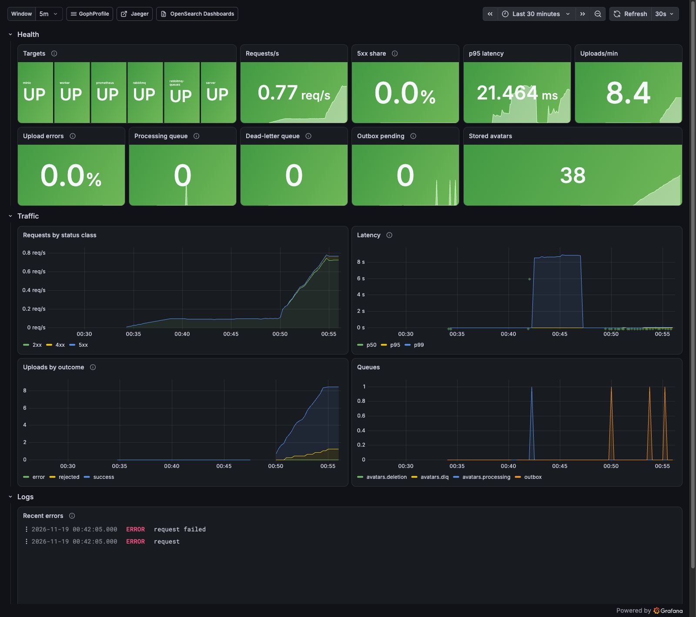
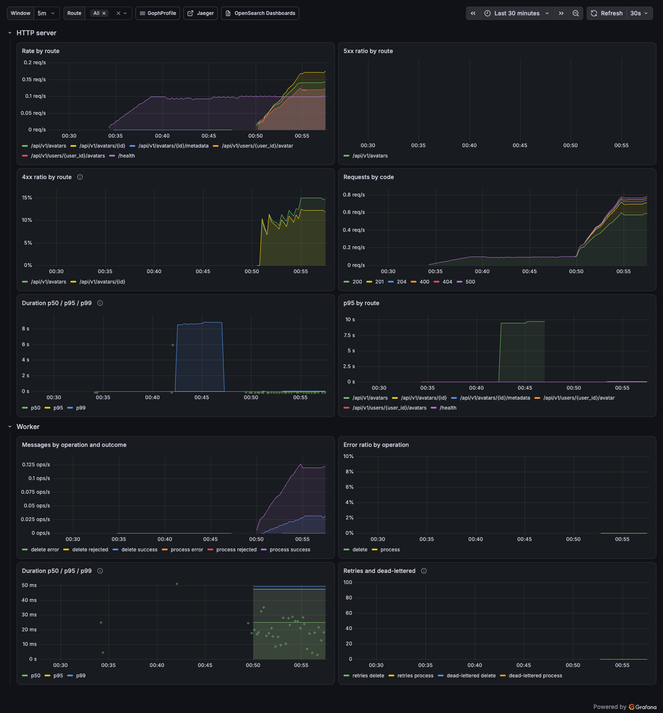
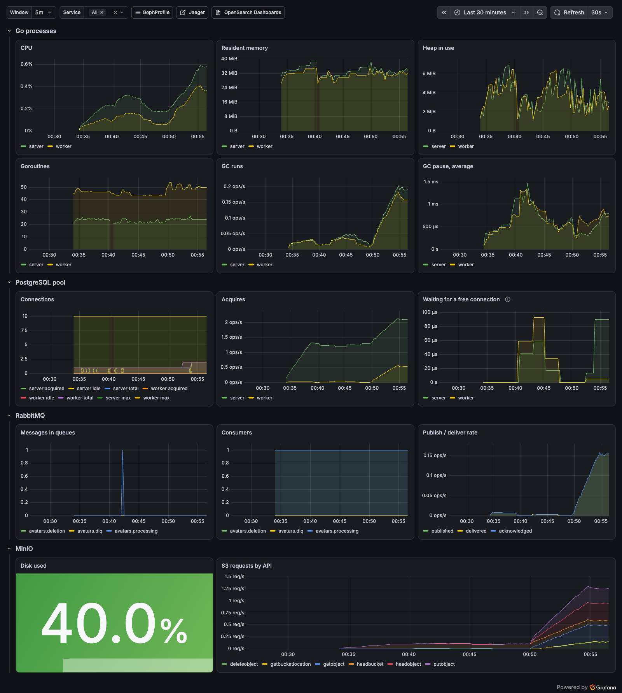
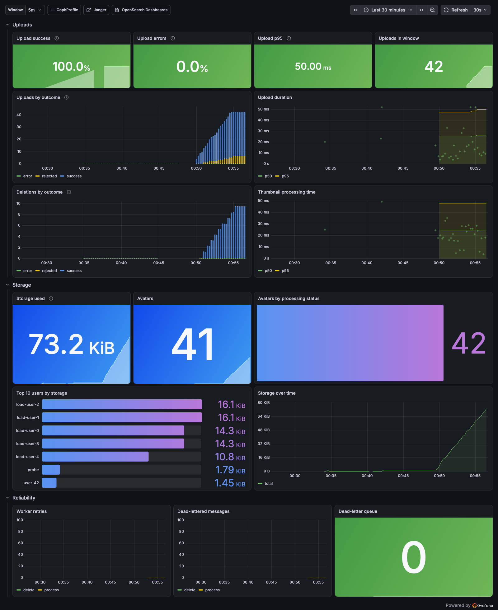

# GophProfile

Сервис аватарок пользователей: загрузка, хранение, обработка и раздача изображений через REST API и веб-интерфейс. Оригинал сохраняется сразу, миниатюры 100×100 и 300×300 строит фоновый воркер, удалённые аватары убираются из хранилища асинхронно.

## Архитектура

```
                   ┌──────────────────────── server ─────────────────────────┐
  клиент ──HTTP──▶ │ handlers (chi) ──▶ service ──▶ repository ──▶ PostgreSQL │
  браузер          │                       └──▶ storage ─────▶ MinIO (S3)    │
                   │ relay ◀── таблица outbox в PostgreSQL                   │
                   │   └──▶ broker ──┐                                       │
                   └─────────────────┼───────────────────────────────────────┘
                                     ▼
                     RabbitMQ  avatars.exchange (topic)
                       avatar.uploaded ─┐   avatar.deleted
                       avatar.process  ─┤          │
                                        ▼          ▼
                       avatars.processing   avatars.deletion
                                        │          │
                   ┌─────── worker ─────┼──────────┼────────────────────┐
                   │ worker ──▶ service.Processor ──▶ PostgreSQL, MinIO │
                   └────────────────────────────────────────────────────┘
                     сообщения, не обработанные после всех попыток ──▶ avatars.dlx ──▶ avatars.dlq
```

Слои (`internal/`):

- `domain` — сущность аватара, статусы, размеры и форматы, события, ошибки. Без зависимостей.
- `service` — сценарии: загрузка, выдача (в том числе конвертация и ресайз на лету), удаление, обработка событий воркером. Работает через интерфейсы из `service/ports.go`.
- `handlers` — REST API, веб-интерфейс, `/health`, middleware безопасности.
- `repository/postgres`, `storage/s3`, `broker/rabbitmq` — адаптеры к PostgreSQL (pgx, миграции golang-migrate встроены в бинарник), MinIO (minio-go) и RabbitMQ (amqp091-go).
- `imaging` — определение формата по magic bytes, декодирование, ресайз, кодирование JPEG/PNG/WebP.
- `worker` — разбор сообщений, повторные попытки с экспоненциальным backoff, отправка в DLQ.

Поток событий:

1. `POST /api/v1/avatars` проверяет файл, создаёт запись (`upload_status=uploading`), кладёт оригинал в `originals/{id}.{ext}`, затем в одной транзакции отмечает `uploaded` и кладёт событие `avatar.uploaded` в таблицу `outbox`. Клиент сразу получает 201 со статусом `processing`. Если транзакция не прошла, оригинал удаляется из MinIO, а запись помечается `failed`.
2. Воркер берёт сообщение из `avatars.processing`, строит миниатюры `thumbnails/{id}/{size}.jpg`, в одной транзакции сохраняет ключи, ставит `processing_status=completed` и записывает id сообщения в `processed_messages` — повторная доставка того же сообщения ничего не делает.
3. Ошибка обработки повторяется до `WORKER_MAX_RETRIES` раз с задержкой 0.5 с, 1 с, 2 с… (не больше 30 с). После последней попытки статус становится `failed`, сообщение уходит в `avatars.dlq`. Битое сообщение отправляется в DLQ сразу.
4. `DELETE` в одной транзакции помечает запись удалённой (`deleted_at`) и кладёт в `outbox` событие `avatar.deleted` с ключами файлов; воркер удаляет объекты из MinIO, только если запись действительно помечена удалённой. Если аватар удалили во время обработки, воркер убирает уже созданные миниатюры.

События отправляет в RabbitMQ relay внутри сервера (transactional outbox): раз в секунду он забирает из `outbox` пачку событий (`FOR UPDATE SKIP LOCKED`, так что несколько реплик сервера не мешают друг другу), публикует их с подтверждением брокера и удаляет отправленные. Если RabbitMQ недоступен, события ждут в таблице и уходят после восстановления связи, поэтому аватар не может навсегда остаться в `processing` из-за потерянного события. Доставка «хотя бы один раз»: id строки outbox становится `message_id`, и воркер отбрасывает повторы по `processed_messages`.

Пока миниатюр нет, `?size=100x100` отдаётся ресайзом оригинала на лету. В списке аватаров только успешно загруженные записи.

Сервер сам отправляет только `avatar.uploaded` и `avatar.deleted`. Пересобрать миниатюры можно вручную: отправить в `avatars.exchange` с ключом `avatar.process` и новым UUID в `message_id` событие `{"avatar_id":"…","operations":[{"type":"resize","size":"100x100"}]}`, например из management UI RabbitMQ (http://localhost:15672).

## Запуск в Docker

```sh
make env                       # .env из .env.example со случайными паролями
docker compose up --build -d   # или make up
```

Логины и пароли PostgreSQL, RabbitMQ и MinIO задаются только в `.env` (он не коммитится), без них `docker compose` не запустится. Пароли можно вписать в `.env` и вручную, но они попадают в URL подключения, поэтому должны быть URL-safe. PostgreSQL и RabbitMQ запоминают учётные данные при первом запуске, поэтому после их смены тома нужно пересоздать: `docker compose down -v`.

`.env`, созданный до появления стека наблюдаемости, нужно дополнить строками `GRAFANA_ADMIN_PASSWORD=<пароль>` и `OTEL_EXPORTER_OTLP_ENDPOINT=http://localhost:4317` из `.env.example`: `make env` не перезаписывает существующий файл, а Compose без пароля Grafana не запустится.

Поднимаются server (`http://localhost:8080`), worker, PostgreSQL, RabbitMQ (management — `http://localhost:15672`) и MinIO (консоль — `http://localhost:9001`). Server и worker собираются в один образ из `docker/Dockerfile`. При потере соединения с RabbitMQ оба процесса завершаются, и Compose перезапускает их. Логи — `make logs`, остановка — `make down`. Вместе с сервисом поднимается стек наблюдаемости, см. [Наблюдаемость](#наблюдаемость).

MinIO запускается из образа `pgsty/minio` — официальные образы MinIO больше не публикуются.

## Наблюдаемость

```
 server, worker ──OTLP/gRPC :4317──▶ Jaeger ◀──────────────┐
      │                                                    │ exemplars, trace по ID
      ├── /metrics :9091 ──▶ Prometheus ──▶ Grafana ───────┘
      │   RabbitMQ :15692 ──▶     │  rules          │ логи (плагин OpenSearch)
      │   MinIO :9000     ──▶     ▼                 ▼
      │                     Alertmanager ──webhook──▶ alert-receiver
      │                                                ▲
      └── stdout (JSON) ──fluentd──▶ Fluent Bit ──▶ OpenSearch ──monitor──┘
                                                       ▲
                                         OpenSearch Dashboards (Discover → trace_id → Jaeger)
```

| Сервис | Адрес | Что там |
|---|---|---|
| Jaeger | http://localhost:16686 | Трейсы: HTTP-запрос → сервис → PostgreSQL/S3 → outbox → RabbitMQ → worker; System Architecture — граф зависимостей |
| Prometheus | http://localhost:9090 | Метрики server, worker, RabbitMQ, MinIO, Alertmanager; Status → Targets, Alerts |
| Alertmanager | http://localhost:9093 | Активные алерты и тишины; уведомления уходят webhook-ом в контейнер `alert-receiver` |
| Grafana | http://localhost:3000 | Логин `admin`, пароль — `GRAFANA_ADMIN_PASSWORD` из `.env`; дашборды в папке GophProfile |
| OpenSearch Dashboards | http://localhost:5601 | Логи server и worker: Discover, сохранённые поиски «Ошибки» и «По trace_id», Alerting |

Переменные для наблюдаемости: `OTEL_EXPORTER_OTLP_ENDPOINT` (куда слать трейсы, в Compose `http://jaeger:4317`; пусто — трейсинг выключен), `TRACE_SAMPLE_RATIO` (доля записываемых новых трейсов от 0 до 1, по умолчанию 1), `METRICS_ADDRESS` (адрес `/metrics`, по умолчанию `:9091` у сервера и `:9092` у воркера), `GRAFANA_ADMIN_PASSWORD` (только в `.env`, генерирует `make env`).

Весь стенд занимает около 3 ГБ памяти Docker, больше всего — OpenSearch (heap 512 МБ, около 1.2 ГБ на контейнер) и Grafana. На Linux OpenSearch требует `sysctl -w vm.max_map_count=262144`; Docker Desktop это уже настроил. При первом старте Grafana скачивает с grafana.com плагин OpenSearch.

### Трейсы

Server и worker отправляют трейсы по OTLP/gRPC в Jaeger. Один trace покрывает загрузку целиком: HTTP-спан, спаны сервиса, запросы PostgreSQL (`postgres.*` и otelpgx), `s3.put_object`, публикацию из outbox (контекст трейса хранится в строке `outbox.trace_context`), получение сообщения воркером, его спаны S3 и БД. Удаление — так же, до удаления файлов воркером. Ретраи воркера — события в спане.

Сэмплер — `ParentBased(TraceIDRatioBased)`: новый трейс записывается с вероятностью `TRACE_SAMPLE_RATIO`, а продолжение чужого трейса (из `traceparent` или из сообщения outbox) следует решению родителя, поэтому трейс server → worker не рвётся. На стенде доля равна 1 (пишется всё), в бою её стоит снизить, например до `0.05`. Exemplars в метриках ставятся только для записанных трейсов.

Каждый ответ API содержит заголовок `X-Trace-ID`:

```sh
curl -si -H 'X-User-ID: gopher' -F file=@cat.png localhost:8080/api/v1/avatars | grep -i x-trace-id
# X-Trace-ID: 4bf92f3577b34da6a3ce929d0e0e4736  →  http://localhost:16686/trace/4bf92f3577b34da6a3ce929d0e0e4736
```

Jaeger 2.23 отдаёт список сервисов и поиск трейсов только через `/api/v3`, поэтому в Grafana включён флаг `jaegerEnableGrpcEndpoint`. Трейс по ID и переход из exemplar работают в Grafana, поиск трейсов по сервису — в UI Jaeger.

### Метрики

Server и worker отдают `/metrics` (Prometheus и OpenMetrics с exemplars `trace_id`):

| Метрика | Тип | Метки | Что считает |
|---|---|---|---|
| `http_requests_total` | counter | `method`, `route`, `code` | HTTP-запросы; `route` — шаблон chi, не сырой путь |
| `http_request_duration_seconds` | histogram | `method`, `route` | время ответа |
| `http_requests_in_flight` | gauge | | запросы в обработке |
| `avatars_uploads_total` | counter | `status`: `success`, `rejected`, `error` | загрузки; `rejected` — ошибка клиента (формат, размер, user id, оборванный запрос), `error` — сбой сервиса |
| `avatars_upload_duration_seconds` | histogram | `status` | время загрузки |
| `avatars_deletes_total` | counter | `status` | удаления |
| `avatars_storage_bytes` | gauge | `user_id` | объём оригиналов у 10 пользователей с наибольшим объёмом |
| `avatars_storage_total_bytes` | gauge | | объём всех оригиналов, по всем пользователям |
| `avatars_total` | gauge | `processing_status` | аватары по статусу обработки |
| `outbox_pending_events` | gauge | | события, ещё не отправленные в RabbitMQ |
| `avatars_processing_total` | counter | `operation`: `process`, `delete`; `status`: `success`, `error`, `skipped` | сообщения, обработанные воркером; `skipped` — повтор уже обработанного |
| `avatars_processing_duration_seconds` | histogram | `operation` | время обработки сообщения вместе с ретраями |
| `worker_retries_total` | counter | `operation` | повторные попытки |
| `worker_dead_lettered_total` | counter | `operation` | сообщения, отправленные в DLQ |
| `db_pool_connections` | gauge | `state`: `acquired`, `idle`, `total` | соединения пула pgx |
| `db_pool_max_connections`, `db_pool_acquires_total`, `db_pool_empty_acquires_total`, `db_pool_empty_acquire_wait_seconds_total` | | | размер пула, выдачи соединений и ожидание свободного |

Плюс стандартные `go_*` и `process_*`. Статистику хранилища, число аватаров и outbox отдаёт только server — запросом в PostgreSQL при каждом scrape. Метка `user_id` есть только у топ-10 по объёму: число временных рядов не растёт вместе с числом пользователей, а объём конкретного пользователя виден по запросу из размеров в `GET /api/v1/users/{user_id}/avatars`. Счётчики по известным меткам начинаются с нуля, поэтому графики и алерты видят 0, а не пропуск. Prometheus также снимает RabbitMQ (`rabbitmq_detailed_queue_messages{queue}` и общие счётчики сообщений) и MinIO (`minio_s3_requests_total`, ёмкость дисков).

### Дашборды

В Grafana в папке GophProfile четыре дашборда (`deploy/grafana/dashboards`, подключаются provisioning-ом):

- **Service overview** — состояние targets, RPS, доля 5xx, p95, загрузки в минуту, очереди и DLQ, outbox, число сработавших алертов, последние ошибки из OpenSearch;
- **RED** — rate, доля ошибок и p50/p95/p99 по `route` для HTTP и по операциям воркера, exemplars ведут в Jaeger;
- **Resources** — CPU, память, горутины и GC процессов, пул PostgreSQL, очереди и consumers RabbitMQ, диск и запросы MinIO;
- **Business KPIs** — загрузки и удаления по исходу, успешность и p95 загрузки, время обработки миниатюр, объём хранилища и топ-10 пользователей, ретраи и DLQ.

Пороги цветов на stat-панелях совпадают с порогами алертов. Нагрузку для графиков даёт `make load` (`scripts/load.sh`: загрузки, чтение, миниатюры, отклонённые файлы и удаления в темпе ниже лимита загрузок; `DURATION=300` — пять минут). Скриншоты сняты во время остановки MinIO:

| Overview | RED |
|---|---|
|  |  |
| **Resources** | **Business KPIs** |
|  |  |

### Логи

Логи server и worker — JSON (slog) с полями `service`, `level`, `msg`, `trace_id`, `span_id`, `request_id`, `user_id`, `avatar_id`, `route`, `status`. Docker отдаёт их драйвером `fluentd` в Fluent Bit (`deploy/fluent-bit`), тот разбирает JSON и пишет в OpenSearch в индексы `gophprofile-logs-YYYY.MM.DD`; строки не в JSON (например, паника) сохраняются в поле `log`. `docker compose logs` продолжает работать.

Одноразовый контейнер `opensearch-init` (`deploy/opensearch/init.sh`) создаёт шаблон индекса, политику удаления индексов старше 7 дней, index pattern, сохранённые поиски, канал Notifications `gophprofile-alert-receiver` и монитор Alerting `gophprofile-error-logs`: раз в минуту он проверяет, были ли записи `level:ERROR` за последние 5 минут, и если были — отправляет webhook в `alert-receiver` (не чаще раза в 10 минут).

Примеры фильтров в Discover: `trace_id:<X-Trace-ID>`, `level:ERROR`, `user_id:gopher`, `service:gophprofile-worker and avatar_id:<id>`. Значение `trace_id` в Discover — ссылка на трейс в Jaeger. Последние ошибки видны и на overview-дашборде Grafana.

OpenSearch запускается без security-плагина и слушает только `127.0.0.1` — это стенд для разработки.

### Алерты

Правила — `deploy/prometheus/alerts.yml`, тесты на синтетических сериях — `deploy/prometheus/alerts_test.yml` (`make test-alerts`, promtool из образа Prometheus; то же в CI). Alertmanager (`deploy/alertmanager`) группирует по `alertname` и шлёт warning и critical разными маршрутами (`/alertmanager/warning`, `/alertmanager/critical`) в `alert-receiver` — эхо-сервер, который печатает каждый запрос: `docker compose logs -f alert-receiver`. На overview-дашборде — счётчик сработавших алертов и ссылка на Alertmanager.

Проверить вживую:

```sh
make load &                     # фоновая нагрузка, scripts/load.sh
docker compose stop minio       # загрузки отвечают 500
# ~1 мин: HighErrorRate pending в http://localhost:9090/alerts, ещё 5 мин — firing,
# через group_wait 30 с JSON алерта в docker compose logs alert-receiver
docker compose start minio      # когда ошибки уйдут из 5-минутного окна — "status":"resolved"
docker compose stop worker      # через ~1.5 мин ServiceDown (critical)
docker compose start worker
```

Во время остановки MinIO воркер исчерпывает ретраи, сообщения уходят в `avatars.dlq` — сработает и `DeadLetterQueueGrowing`, а монитор OpenSearch пришлёт webhook об ошибках в логах.

#### HighErrorRate

Больше 10% загрузок за 5 минут завершились ошибкой сервиса (не 4xx), 5 минут подряд. Смотреть `/health`, панель Recent errors и поиск «Ошибки» в OpenSearch Dashboards: чаще всего недоступен MinIO или PostgreSQL. По `trace_id` из лога — трейс в Jaeger, на каком шаге упало.

#### HighResponseTime

p95 загрузки больше 5 секунд 2 минуты подряд. Открыть exemplar на панели Upload duration (Business KPIs) — в трейсе видно, что медленное: `s3.put_object`, транзакция PostgreSQL или публикация. Проверить ресурсы MinIO и пул соединений на дашборде Resources.

#### HTTPHighErrorRate

Больше 5% HTTP-ответов — 5xx. На дашборде RED видно, какой `route`; дальше как для HighErrorRate.

#### ServiceDown

Prometheus не может снять метрики server или worker минуту. `docker compose ps`, `docker compose logs server worker`: процессы завершаются при потере RabbitMQ и перезапускаются Compose.

#### DeadLetterQueueGrowing

Воркер исчерпал ретраи и отправил сообщения в `avatars.dlq`. Причина — в логах `level:ERROR` с `msg:"message failed"`; после устранения сообщения можно вернуть через management UI RabbitMQ (Shovel или Get/Publish) либо удалить.

#### ProcessingBacklog

В `avatars.processing` больше 50 сообщений 5 минут: воркер не успевает или не работает. Проверить consumers на дашборде Resources и время обработки на RED.

#### OutboxBacklog

Больше 100 событий в outbox 5 минут: relay в server не публикует. Проверить доступность RabbitMQ и логи server.

## Запуск для разработки

```sh
make env
make up-deps       # PostgreSQL, RabbitMQ, MinIO
make run-server    # миграции применяются при старте
make run-worker
```

## Настройки

Каждый параметр задаётся флагом или переменной окружения; флаг приоритетнее.

| Переменная | Флаг | По умолчанию | Кто читает |
|---|---|---|---|
| `DATABASE_DSN` | `-d` | обязательна | server, worker |
| `AMQP_URL` | `-amqp` | обязательна | server, worker |
| `S3_ENDPOINT` | `-s3-endpoint` | обязательна (`host:port`) | server, worker |
| `S3_ACCESS_KEY` | `-s3-access-key` | обязательна | server, worker |
| `S3_SECRET_KEY` | `-s3-secret-key` | обязательна | server, worker |
| `S3_BUCKET` | `-s3-bucket` | `avatars` | server, worker |
| `S3_USE_SSL` | `-s3-use-ssl` | `false` | server, worker |
| `LOG_LEVEL` | `-log-level` | `info` | server, worker |
| `OTEL_EXPORTER_OTLP_ENDPOINT` | `-otlp-endpoint` | пусто — трейсы не отправляются | server, worker |
| `TRACE_SAMPLE_RATIO` | `-trace-sample-ratio` | `1` — доля записываемых новых трейсов, от 0 до 1 | server, worker |
| `METRICS_ADDRESS` | `-metrics-address` | `:9091` у server, `:9092` у worker — адрес `/metrics` | server, worker |
| `ADDRESS` | `-a` | `:8080` | server |
| `MAX_UPLOAD_SIZE` | `-max-upload-size` | `10485760` (10 МБ) | server |
| `WEB_DIR` | `-web-dir` | `./web` | server |
| `CORS_ALLOWED_ORIGINS` | `-cors-allowed-origins` | пусто | server |
| `RATE_LIMIT_RPS` | `-rate-limit-rps` | `100` | server |
| `UPLOAD_RATE_LIMIT` | `-upload-rate-limit` | `10` | server |
| `WORKER_PREFETCH` | `-prefetch` | `10` | worker |
| `WORKER_MAX_RETRIES` | `-max-retries` | `5` | worker |

## API

Ошибки возвращаются как `{"error": "...", "details": "..."}`. Поддерживаемые форматы — JPEG, PNG, WebP; размеры — `original`, `100x100`, `300x300`.

Загрузка (multipart, поле `file`, до 10 МБ):

```sh
curl -i -F file=@cat.png -H 'X-User-ID: gopher@example.com' http://localhost:8080/api/v1/avatars
# 201 {"id":"…","user_id":"gopher@example.com","url":"/api/v1/avatars/…","status":"processing","created_at":"…"}
# 400 {"error":"Invalid file format","details":"Supported formats: jpeg, png, webp"}
# 413 {"error":"File too large","max_size":10485760}
```

Картинка по id, с выбором размера и формата (по умолчанию — оригинал в исходном формате; ответы с `ETag` и `Cache-Control: public, max-age=86400`, поддерживаются `If-None-Match` → 304 без чтения файла и `HEAD`):

```sh
curl -o avatar.png http://localhost:8080/api/v1/avatars/{id}
curl -o thumb.webp 'http://localhost:8080/api/v1/avatars/{id}?size=100x100&format=webp'
```

Текущий (последний загруженный) аватар пользователя; если его нет — PNG-заглушка. Он меняется после каждой загрузки и удаления, поэтому отдаётся с `Cache-Control: no-cache`: браузер каждый раз сверяет `ETag` и получает 304, пока аватар тот же:

```sh
curl -o me.jpg 'http://localhost:8080/api/v1/users/gopher@example.com/avatar?size=300x300'
```

Метаданные и список аватаров пользователя (новые первыми):

```sh
curl http://localhost:8080/api/v1/avatars/{id}/metadata
# {"id":"…","user_id":"…","file_name":"cat.png","mime_type":"image/png","size":1024,
#  "dimensions":{"width":640,"height":480},
#  "thumbnails":[{"size":"100x100","url":"/api/v1/avatars/…?size=100x100"}, …],
#  "status":"ready","url":"/api/v1/avatars/…","created_at":"…","updated_at":"…"}
curl http://localhost:8080/api/v1/users/gopher@example.com/avatars
```

`status`: `processing` — миниатюры ещё строятся, `ready` — готовы, `failed` — не удалось загрузить или обработать.

Удаление — только своих аватаров (`X-User-ID` должен совпадать с владельцем):

```sh
curl -i -X DELETE -H 'X-User-ID: gopher@example.com' http://localhost:8080/api/v1/avatars/{id}
curl -i -X DELETE -H 'X-User-ID: gopher@example.com' http://localhost:8080/api/v1/users/gopher@example.com/avatar
# 204; чужой — 403 {"error":"Forbidden","details":"You can only delete your own avatars"}; нет такого — 404
```

Состояние зависимостей (200 или 503 `degraded`; подробности ошибки — в логе сервера):

```sh
curl http://localhost:8080/health
# {"status":"ok","components":{"broker":"ok","database":"ok","storage":"ok"}}
```

## Веб-интерфейс

`http://localhost:8080/` открывает форму загрузки, галерея пользователя — `/web/gallery/{user_id}`: миниатюры, статус обработки (обновляется раз в 2 секунды) и удаление. Страница основана на шаблоне курса [go-avatar-service-template](https://github.com/Yandex-Practicum/go-avatar-service-template) (MIT), стили Tailwind подключаются с CDN. Без JavaScript форма отправляется на `POST /web/upload` и после загрузки перенаправляет в галерею.

## Безопасность

- Формат определяется по magic bytes (JPEG, PNG, WebP), расширение и `Content-Type` клиента не учитываются. Перед декодированием проверяются размеры — больше 8000×8000 отклоняется (защита от decompression bomb), затем файл декодируется целиком: обрезанные файлы и данные после конца PNG или WebP (полиглоты) дают 400.
- Тело запроса ограничено через `MaxBytesReader` на обоих путях загрузки (`POST /api/v1/avatars` и `POST /web/upload`): `MAX_UPLOAD_SIZE` плюс 1 МБ на служебные части multipart, превышение — 413.
- Rate limiting по IP клиента (`RemoteAddr`): общий лимит на `/api/*` — `RATE_LIMIT_RPS` запросов в секунду, отдельный на загрузку через API и веб вместе — `UPLOAD_RATE_LIMIT` в минуту. Ответ 429 `{"error":"Too many requests"}` с `Retry-After`. Значение `0` отключает лимит. За обратным прокси все клиенты попадут в одну корзину — тогда лимиты нужно ставить на прокси.
- CORS: `CORS_ALLOWED_ORIGINS` — список origin через запятую (`*` — любой), им разрешены `GET, POST, DELETE` с заголовками `Content-Type, X-User-ID`. Картинки (`GET /api/v1/avatars/{id}`, `GET /api/v1/users/{user_id}/avatar`) доступны с любого origin, чтобы их можно было встраивать на сторонние сайты.
- `X-User-ID` и `{user_id}` в пути: непустая строка до 255 символов из `A-Z a-z 0-9 . _ % + @ -`, иначе 400 `{"error":"Invalid user id"}`.
- Все ответы идут с `X-Content-Type-Options: nosniff`, картинки — с `Content-Disposition: inline`. Имя файла из формы очищается от путей и управляющих символов и обрезается до 255 символов перед записью в БД. Внутренние ошибки возвращаются клиенту как `{"error":"Internal server error"}` без подробностей.

## Тесты и линтер

```sh
make test               # unit-тесты с -race
make cover              # покрытие unit-тестами (без cmd/)
make test-integration   # unit + интеграционные; нужен Docker, PostgreSQL, MinIO и RabbitMQ поднимаются через testcontainers
make lint               # golangci-lint v2
make test-alerts        # конфиги Prometheus и Alertmanager, promtool test rules; нужен Docker
```

Интеграционные тесты помечены build-тегом `integration`. Тесты трейсинга работают на in-memory exporter (`internal/telemetry/telemetrytest`), метрик — на отдельном registry. В CI (`.github/workflows/test.yml`) отдельными job идут линтер, unit-тесты с покрытием, интеграционные тесты, `make test-alerts` и проверка `docker compose config`.
